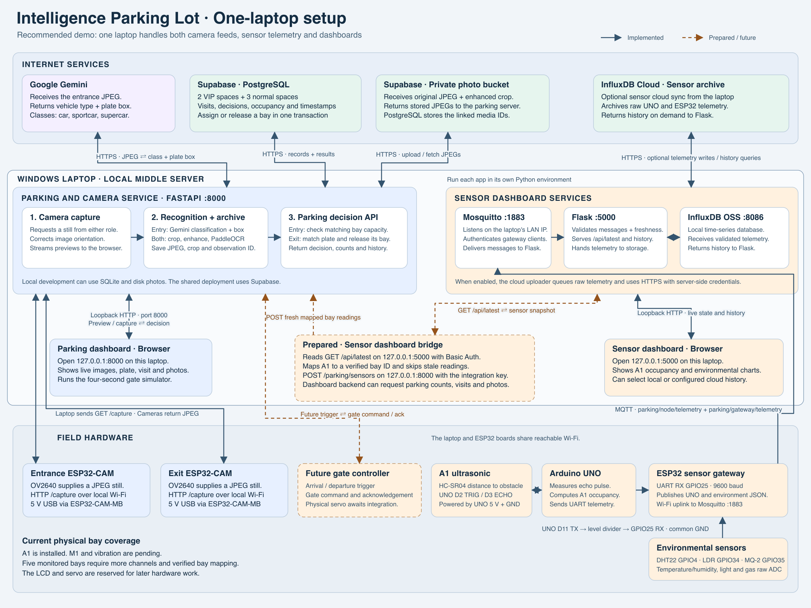
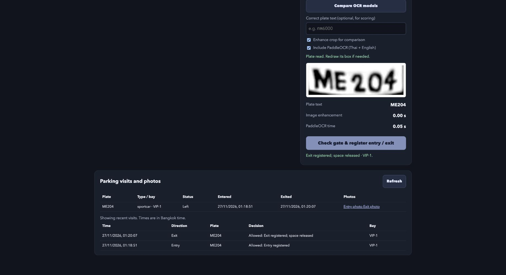

# Intelligence Parking Lot

Intelligence Parking Lot combines two ESP32-CAM cameras, Gemini vehicle classification, local PaddleOCR, and a five-space parking ledger. The web dashboard previews both cameras, reads plates, checks available spaces by vehicle type, and records simulated gate decisions. Run with SQLite and local photos for development or use Supabase for shared records and private photo storage.



## Recommended demo setup

Use the Windows laptop that already runs the sensor dashboard as the local server for both projects. Keep each project in its own Python environment. Both dashboards and the sensor bridge can use loopback addresses, so communication between the apps stays on the laptop. Keep the laptop awake during the demo because it serves both dashboards.

| Service | Address | Connection |
|---|---|---|
| Parking dashboard and camera previews | `http://127.0.0.1:8000` | The browser connects to FastAPI. FastAPI requests a JPEG from each ESP32-CAM over Wi-Fi. |
| Sensor dashboard | `http://127.0.0.1:5000` | The browser connects to Flask for live readings and history. |
| Mosquitto | Laptop Wi-Fi IP, TCP `1883` | The ESP32 sensor gateway publishes telemetry over Wi-Fi. |
| InfluxDB OSS | `http://127.0.0.1:8086` | Flask stores and reads local sensor history. |

1. Start the companion sensor services on the Windows laptop with `scripts/start-native.ps1` from its project directory. Keep the laptop, both cameras and the sensor gateway on a reachable Wi-Fi network. Use the laptop's Wi-Fi IP for the gateway's broker address. [Companion sensor setup](https://github.com/ananyaknr/iot-parking-dashboard#start-and-stop)
2. Set up the parking project on the same laptop using the steps below. Configure both capture URLs and start FastAPI on port `8000`. The laptop uses internet access for Gemini classification and, when configured, the Supabase ledger and photo archive. The sensor dashboard can also use its optional InfluxDB Cloud archive.
3. Open the two dashboards on the laptop. Once the physical sensor-to-bay mapping is confirmed and Supabase is configured, the optional bridge can read Flask on port `5000` and forward occupancy to FastAPI on port `8000`. [Sensor bridge setup](docs/sensor-dashboard-integration.md#adapter-for-the-existing-sensor-project)

## How it works

1. **Entrance.** Select Entrance and click **Simulate sensor alert** to take a fresh JPEG over Wi-Fi. Gemini receives the still image and returns a vehicle type and proposed plate box. The parking server crops and enhances the plate, then reads Thai or English text locally with PaddleOCR.
2. **Review.** Check the vehicle type and plate. If the box is off, draw a new one around the registration characters and click **Read selected plate**. A recrop of the same entrance photo reuses its Gemini result. You can also use **Or open a test photo** and draw the plate box to test without a camera.
3. **Admission.** Click **Check gate & register entry / exit**. The backend uses the saved observation to check capacity and allocate a matching bay. The web gate opens for four seconds after a new approved decision.
4. **Exit.** Select Exit and repeat the capture and review. Exit runs PaddleOCR locally. When the plate matches an active visit, the backend closes that visit and releases its assigned bay. The dashboard displays availability, entry and exit times in Bangkok time, decisions, and archived photo links.

| Spaces | Vehicle types | Capacity |
|---|---|---:|
| `VIP-1`, `VIP-2` | Sports cars (`sportcar`) and supercars (`supercar`) | 2 |
| `NORMAL-1`, `NORMAL-2`, `NORMAL-3` | Normal passenger cars (`car`) | 3 |

A car can use only its matching type of space. Full matching bays, uncertain recognition, duplicate entry and unmatched exit keep the gate closed. A matching exit can leave when the lot is full. Admission and release are transactional. Retrying the same observation and request ID returns the original decision without a second allocation or OPEN command.

The web gate is a simulator. The optional sensor bridge supplies physical occupancy readings independently of registered entries and exits. Hardware trigger and physical gate control are future integrations. [Entry and exit decision diagram](docs/parking-decision-flow.png) · [System diagram SVG](docs/parking-system-flow.svg)

## Run locally

Use Python 3.11. Clone the repository and set up the local environment.

```bash
git clone https://github.com/vvryw/intelligence-parking-lot.git
cd intelligence-parking-lot
python3.11 -m venv .venv
source .venv/bin/activate
python -m pip install -r requirements-dev.txt
cp -n .env.example .env
python scripts/setup_paddleocr.py
```

In Windows PowerShell use `py -3.11 -m venv .venv`, then `.\.venv\Scripts\Activate.ps1`. Install the same requirements, run the model setup, and copy `.env.example` to `.env` if it does not exist.

Set `GEMINI_API_KEY` in the local `.env` for entrance classification. Exit OCR and camera previews can run without the key. The example configuration uses SQLite and saves photos under `data/storage/photos/`. For a cloud setup, follow the Supabase section below.

```bash
python -m uvicorn app.main:app --host 127.0.0.1 --port 8000
```

Open the dashboard at [http://127.0.0.1:8000](http://127.0.0.1:8000/) and the interactive API reference at [http://127.0.0.1:8000/docs](http://127.0.0.1:8000/docs).

## Connect both cameras

1. Copy `camera/parking_camera/wifi_secrets.h.example` to `camera/parking_camera/wifi_secrets.h` and enter the 2.4 GHz Wi-Fi settings locally. For the included AI Thinker-compatible firmware, flash each board using its ESP32-CAM-MB USB adapter. Label one Entrance and the other Exit.
2. With the board powered and on the same reachable network as the backend, read its JPEG capture URL from the serial monitor or run `python -m app.camera_setup --camera entrance --port YOUR_USB_PORT`. Repeat with `--camera exit` and the second port. The helper checks a photo before updating `.env`.
3. Set `ESP32_ENTRANCE_CAPTURE_URL` and `ESP32_EXIT_CAPTURE_URL` to the respective `http://CAMERA_IP/capture` endpoints if configuring manually. `ESP32_CAPTURE_URL` is the legacy entrance alias. Restart the backend after changing these values.
4. After flashing, each camera can use a 5 V USB power supply through its MB adapter. Images travel over Wi-Fi. If a preview is offline, check current IP, power stability and network reachability. The dashboard can still use uploaded photos.

The backend corrects orientation before sending frames to preview or OCR. The preview has a flip toggle. For setup and troubleshooting, see the [ESP32-CAM guide](camera/README.md).

## Supabase database and photo storage

1. Apply [migration 001](migrations/001_parking_supabase.sql) in the Supabase SQL editor. It creates and seeds the five bays, creates the private `intelligence-parking-lot` bucket if needed, and creates or extends the parking tables. [Migration 002](migrations/002_fix_parking_function_scope.sql) is the patch for projects that applied the earlier version of migration 001.
2. Set `PARKING_BACKEND=supabase`, `SUPABASE_URL`, `SUPABASE_SECRET_KEY`, and `SUPABASE_STORAGE_BUCKET` in the backend's ignored `.env`. Use your project URL and server-only secret. The default bucket name matches the migration.
3. Restart the backend. The dashboard should show **Supabase connected** and the bay counts.

The database stores bay types, recognition observations, visits, decisions, simulated gate commands and the latest occupancy per connected sensor. A registered entry creates a `still_in` visit. A matching exit changes it to `left` and records a UTC timestamp. Original photos and enhanced crops go to the private bucket, and the local backend serves them to the dashboard.

In Supabase mode, the cloud ledger is authoritative. If a transaction result is uncertain, the dashboard keeps the simulator closed and the same observation can be retried. Table access and parking RPCs are restricted to the backend role. Keep the API on loopback or behind authentication because it exposes parking history and photos. Wi-Fi credentials, backend secrets, photos, databases and downloaded weights belong in local files.

## Sensor dashboard connection

The companion sensor system sends ultrasonic readings through Arduino UNO, an ESP32 gateway and MQTT to its Flask dashboard and InfluxDB. The parking bridge reads the dashboard's authenticated `GET /api/latest`, maps verified channels to bay IDs, and sends fresh Boolean occupancy and UTC observation times to `POST /parking/sensors` using `X-Integration-Key`. Set `SENSOR_INTEGRATION_TOKEN` on the server for this connection. The sensor endpoint uses Supabase.

An occupied or stale sensor reading makes a bay unavailable. Older readings cannot overwrite newer ones. To require fresh vacancy evidence for every usable bay, set `PARKING_REQUIRE_FRESH_SENSORS=true`. The current companion setup exposes A1 and marks M1 uninstalled. A live rollout needs verified physical mapping and more channels for all five bays.

The companion sensor dashboard has its own local InfluxDB history and can archive raw telemetry to InfluxDB Cloud when configured. Its backend can also read parking counts, visit history and photos through the parking API. The [integration guide](docs/sensor-dashboard-integration.md) provides mapping, payload and network setup. See also the [OpenAPI contract](docs/openapi.json) and the [companion sensor repository](https://github.com/ananyaknr/iot-parking-dashboard).

## Recognition and API

The default classifier is `gemini-3.5-flash-lite`. For busy, rate-limited or timed-out requests, the default configuration tries `gemini-3.1-flash-lite` once. The primary and fallback attempts are capped at 8 and 15 seconds respectively. `GEMINI_MODEL` selects a different model. The optional `GEMINI_API_KEY_SECONDARY` and `GEMINI_API_KEY_TERTIARY` rotate keys between entrance classifications.

PaddleOCR PP-OCRv5 Mobile runs Thai, English and digit recognition locally on the CPU through RapidOCR and ONNX Runtime. The pipeline levels shadows and enhances contrast on the selected crop. `PADDLEOCR_MIN_CONFIDENCE` defaults to 0.60. If the plate still reads incorrectly, redraw the box around the registration row and check focus and lighting.

| Endpoint | Purpose |
|---|---|
| `GET /camera/stream`, `GET /camera/snapshot` | Preview or take a fresh still from `camera=entrance\|exit` |
| `POST /parking/analyze` | Analyze and archive an uploaded still. Accepts an optional plate box and returns an observation ID. |
| `POST /parking/commit` | Register an entry or exit using the observation ID and a stable request ID. |
| `GET /parking/status`, `GET /parking/history` | Read bay counts, visits and decisions. |
| `GET /parking/media/{uuid}` | Read an archived JPEG through the backend. |
| `POST /parking/sensors` | Submit timestamped occupancy readings using the integration key. |
| `POST /infer`, `POST /capture` | Run recognition on an uploaded or live image. These routes return analysis for existing callers. |
| `POST /classify`, `POST /plate/read`, `POST /plate/compare` | Run standalone classification, OCR or OCR comparison. |

Plate boxes are `x1,y1,x2,y2` in original-image pixels. An [example inference response](examples/sample_response.json) shows the classification, OCR result, confidence and timings.

```bash
python -m app.cli --image /path/to/vehicle.jpg
python -m app.cli --camera exit --camera-url
python -m app.cli --camera entrance --camera-url --capture-only data/samples/entrance.jpg
```

### Compare OCR engines

```bash
python -m pip install -r requirements-ocr-compare.txt
python scripts/setup_openthai.py
```

Draw a plate box and click **Compare OCR models** to compare EasyOCR, OpenThai OCR Text 2.0.0 and PaddleOCR on the same crop. Enter reference text to see exact match and character error rate. Toggle enhancement to compare against the raw crop.

On four toy-car screenshots with manually selected crops, enhanced PaddleOCR matched 3/4 plates with a warm median of 45.5 ms. EasyOCR and OpenThai each matched 0/4 on the enhanced crops. These timings cover OCR on the selected crop and exclude model loading, camera fetch, enhancement and Gemini. Accuracy on physical license plates still needs a larger camera test. [Four-image benchmark](reports/ocr_four_camera_results.md) · [Test method and findings](reports/ocr_four_camera_recommendation.md)

## Test and verify

```bash
python -m pytest -q
```

The software test suite covers OCR, camera capture, API validation, allocation, duplicate requests, exits and the sensor bridge. Run `python scripts/verify_parking_cloud.py` against an empty Supabase test lot to exercise live capacity and private storage with temporary test records.

The cloud and browser tests confirmed that vehicles fill only their matching bays and that a matching exit releases its assigned space. In the browser test, the ME204 toy car was classified as a sports car, assigned `VIP-1`, and then marked as left. Both saved photos could be read back and all five bays were available after the exit. [Cloud checks](reports/parking_cloud_verification.json) · [Browser test](reports/parking_web_verification.json) · [Sensor API checks](reports/parking_sensor_cloud_verification.json)


