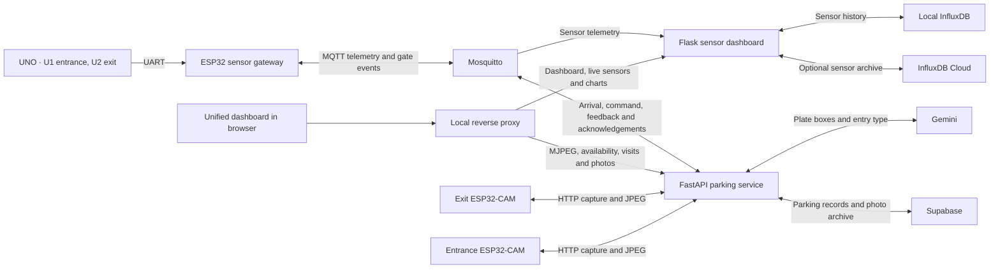

# Two-repo migration to one parking dashboard

**November 27, 2026 (Bangkok) · Original migration plan**

For the current joint simulation, use camera commit [`3046eb2`](https://github.com/vvryw/intelligence-parking-lot/tree/3046eb2) with sensor main [`f92ef31`](https://github.com/ananyaknr/iot-parking-dashboard/tree/f92ef31). The sensor repo now includes the unified dashboard, and the camera repo includes Gemini exit plate detection and the passage-aware API and worker. The baseline and proposals below describe the earlier planning checkpoint. Use the [current startup guide](passage-joint-test.md) and [OpenAPI specification](passage-openapi.json) for the exact ports, topics and API. The live joint acceptance run remains pending.

Use the sensor team's existing dashboard as the operator screen. Run it and the camera/parking service on the same Windows laptop. Keep the two repositories and their databases separate. Put one local web address in front of both services so the dashboard can show entrance and exit video, sensor charts, parking availability, visits, photos and gate status together.

The browser should display decisions and submit operator requests. FastAPI and Supabase should remain responsible for matching plates, reserving bays and recording entry and exit. The sensor team should continue to own the UNO, ESP32 gateway, MQTT, gate behavior and telemetry.

## Baseline in both repositories

| Source inspected | Available now | Work still required |
|---|---|---|
| [Camera repo main at `1058ed1`](https://github.com/vvryw/intelligence-parking-lot/tree/1058ed1) | Two MJPEG camera previews, fresh stills, entrance classification, local PaddleOCR, Supabase visits and private photos, 2 VIP and 3 normal bays, HTTP gate simulation | Shared dashboard routes and MQTT workflow. The current simulated exit releases the bay on HTTP commit. |
| Camera repo local changes on top of `1058ed1` | Gemini exit plate box, local fallback, PaddleOCR comparison of raw and enhanced crops, manual correction. Both streams were verified on the Mac. The assisted flow read 3 of 4 supplied test photos exactly. | Include these changes in the camera team release before deploying to the Windows laptop. This OCR update was local at the time of inspection. |
| [Sensor repo main at `8d3b445`](https://github.com/ananyaknr/iot-parking-dashboard/tree/8d3b445) | Flask dashboard with environmental charts, gate telemetry and local/cloud history. Existing gate demo uses G2 with U1 arrival and U2 passage. Its recognition adapter is for isolated synthetic tests. | Add the camera/parking panels. Preserve G2 event meanings and keep its mock recognition endpoint outside the new gate decision flow. |
| [Sensor integration branch at `b86e5eb`](https://github.com/ananyaknr/iot-parking-dashboard/tree/b86e5eb) | Proposed entrance/exit contract and local UNO preparation. The branch records a servo-disabled upload and sensor follow-up checks. | Shared MQTT encoding, gateway and backend integration, U2 no-echo diagnosis, and stable bidirectional UART. The latest restoration receipt still reports U2 no echo and `UART_SESSION=0`. |

The sensor refs above are the fetched remote refs. The sensor checkout available on this Mac was still at `dae7a70`. Inspect the agreed refs when building on Windows. The [sensor restoration receipt](https://github.com/ananyaknr/iot-parking-dashboard/blob/b86e5eb/docs/uno-servo-restoration.md) separates older bench results from the latest hardware checks.

## Target connections on the Windows laptop

Use one local dashboard URL, for example `http://127.0.0.1:8080`. The port is a proposal. Keep Flask on `127.0.0.1:5000`, FastAPI on `127.0.0.1:8000` and local InfluxDB on `127.0.0.1:8086`. Mosquitto accepts authenticated device connections on the laptop's reachable Wi-Fi IP and TCP port `1883`.

The MQTT connection to FastAPI in this diagram is the target integration. The initial combined dashboard can ship with live cameras and read-only parking data while MQTT remains in isolated simulation.

| Browser path | Upstream | Behavior |
|---|---|---|
| `/`, `/static/*`, `/api/latest`, `/api/history`, `/api/cloud/history`, `/api/gate/events` | Flask | Existing dashboard, telemetry and history. Keep local and cloud chart selection. |
| `/camera/stream?camera=entrance` and `camera=exit` | FastAPI | Same-origin MJPEG from the existing endpoints. Pass multipart chunks through without buffering. Give streams a timeout and reconnect policy separate from regular JSON requests. |
| `/parking/status`, `/parking/history`, `/parking/media/{uuid}` | FastAPI | Read availability, visits and authenticated photo views. Route only known endpoints and UUID photo references. The browser never needs the Supabase key or a camera IP. |
| Future `/api/parking/review/…` routes | FastAPI | Role-checked operator actions such as recrop, review and reconcile. Require a stable request ID for state changes. |
| `/parking/commit`, `/parking/sensors`, existing synthetic recognition POST | Backend or separate isolated test interface | Keep these out of the general dashboard proxy. The existing HTTP simulator must not bypass the new passage workflow. |

Use one operator login at the dashboard entry point. Keep upstream services bound to loopback. Apply the same authentication to the camera and photo paths as to the rest of the dashboard. Require an operator role and same-origin/CSRF protection for state-changing actions. Keep fixed upstream addresses in server configuration. Avoid sending MJPEG through Flask/Waitress request threads because each open stream would occupy a thread needed for the charts and API.

## Final dashboard behavior

| Panel | What it shows | Update and action logic |
|---|---|---|
| Live cameras | Entrance and Exit side by side with independent Live, Reconnecting or Offline indicators | Subscribe to both streams when visible. A snapshot for OCR is a separate fresh frame taken by FastAPI. A stale preview stays labeled stale and cannot be submitted as a new automatic capture. |
| Availability | Two VIP bays for `sportcar`/`supercar` and three normal bays for `car` | Use Supabase counts through FastAPI. Distinguish `available`, `reserved`, `occupied`, `unavailable` and `review`. Deny entry when the matching type is full. Show Unknown when the ledger is unreachable. U1/U2 are lane detectors. Only a verified bay sensor may contribute physical bay occupancy. |
| Gate and recognition | Per-lane trigger, capture, plate box, crop, plate text, vehicle type, decision, gate acknowledgement and passage state | Show distinct status for command accepted, opening, hold, completed passage, failed and review. Keep both direction and arrival ID visible in the details. Simulation is visibly labeled. An outdated response must not overwrite a newer arrival's details. |
| Visits and photos | Last entries and exits, assigned bay, timestamps and linked images | Update from the authoritative session projection after state changes. Display UTC values in Bangkok time. Render plate text as text and pass photos through the authenticated backend. |
| Sensors and charts | Environmental readings, vibration, U1/U2 and gate history | Reuse Flask charts and freshness checks. Add a G3 entrance/exit view when available. Keep historic G2 U2 passage counts separately labeled. Sensor history remains available when parking or Gemini is offline. |
| Operator review | Unreadable plate, unmatched exit, ambiguous entrance, stale arrival and failure reasons | Reuse the camera crop editor. Record why the operator corrected a read or resolved a reservation. For simulation, supervised passage confirmation comes through the sensor/gate controller and produces ordinary correlated feedback. The dashboard does not fabricate feedback by marking a visit left. |

## Functions and files to change

The names under **Add or change** are proposed implementation names. The current entry points are listed so both teams can find the code.

| Repo and current entry point | Add or change | Keep using |
|---|---|---|
| Camera `app/main.py` · `read_camera()`, `camera_jpeg()`, `preview_frames()`, `camera_stream()`, `camera_snapshot()` | Keep the existing stream/snapshot routes. Add a single shared preview producer per role if more than one viewer increases camera traffic. Give event captures priority, enforce freshness, and use one in-flight camera request per device. Expose per-camera health and last-frame age. | Proven orientation correction, per-camera locks, role-specific ESP32 capture URLs. The browsers should share frames rather than causing a new camera request for every viewer. |
| Camera `app/parking_recognition.py` · `ParkingRecognition.analyze()`; `app/pipeline.py` · `extract_plate()`, `read_cropped_plate()` | Add an event worker, for example `process_arrival(arrival_id)`, that calls fresh capture and the existing analysis exactly once per logical event under normal delivery. Persist the job and observation references. If a crash leaves capture outcome uncertain, mark for review or use an explicit audited recapture. | Entrance Gemini type and plate box. Exit Gemini box, PaddleOCR, raw/enhanced comparison, local fallback and manual crop. Preserve `previous_observation_id` so entrance recrops reuse the classification. |
| Camera `app/parking_api.py` · `parking_router()`; `app/supabase_parking.py` · `commit()`, `status()`, `history()` | Add separate methods for reservation, attaching an exit match, recording feedback, completion and reconciliation. Expose reserved counts and per-arrival gate progress in the read API. A manual re-analysis may update the review outcome, but only the orchestration service makes gate decisions. | Existing analysis, photo proxy, history and status. Rename the UI's **Check gate & register entry / exit** button to an explicit simulator action in test mode. Do not call `commit()` from the MQTT worker. |
| Camera `app/web/camera.js` · `startPreview()`, `analyzeParkingPhoto()`, crop handlers, `renderParkingStatus()`, `renderParkingHistory()` | Extract reusable preview, crop/review, and parking-status modules for the Flask dashboard. Scope DOM IDs to the new panels and use same-origin paths. Change the button handler from instant simulated commit to event review / retry or reconciliation where applicable. | Original-image pixel coordinates for manual boxes, direction-aware camera controls, local display of enhanced or raw OCR crop. Keep the old camera page as a diagnostics UI while rolling out. |
| Sensor `backend/webapp.py` · `create_app()`; `dashboard/templates/index.html`; `dashboard/static/app.js` · `live()`, `history()` | Add the camera and parking UI panels, independent fetch/status indicators, and an authenticated review UI. The proxy owns routing for media and camera streams. Create a read-only parking projection if the sensor backend itself needs session summaries. | Existing charts, live freshness rendering and history endpoints. Preserve backend service ownership. |
| Sensor `backend/main.py`, `backend/gate_model.py` · `validate_gate()`, `backend/gate_events.py` · `GateEvents.remember()`; `backend/recognition_adapter.py` | Add a versioned validator, durable event/retry ledger and read-only gate projection for the new entrance/exit flow. Route G3 separately from G2. Keep the synthetic recognition adapter out of the new flow. | MQTT ingestion, historical G2 validation and storage, exact-topic ACL concept, environmental readings and cloud history. |
| Sensor `firmware/uno_gate_sim/uno_gate_sim.ino`, `firmware/esp32_gate_sim/esp32_gate_sim.ino`, `firmware/gate_common`, `infra/mosquitto/acl` | Stabilize U2 readings and UART session establishment first. Implement the agreed G3 messages, stable arrival IDs, supervised confirmation, command expiry/dedup and feedback retry. Apply scoped test ACLs for the two service identities. | Local U2 exit, controller safety checks, simulated movement for joint tests, and separately labeled G2 history. Validate `sportcar` and the ASCII LCD label in the new path. |
| Camera `app/sensor_bridge.py` · `dashboard_sensor_batch()`, `scripts/sync_sensor_dashboard.py` | Keep these optional for real, explicitly mapped bay-level sensors. Skip them in the gate-only migration. Cross-check measured occupy/clear timestamps before enabling strict bay sensing. | Timestamped occupancy, stale/invalid filtering, explicit mapping and separation from gate triggers. |

## Parking transaction and gate state rules

1. **Arrival identity.** Record one `arrival_id` per debounced U1 entrance or U2 exit event. Persist direction, detector, first received time, state and observation reference. Every MQTT message has its own `event_id`. The original IDs and immutable payloads survive retries. Keep a bounded processing queue and reject late entrance requests that can no longer reach the gate within its lane window.
2. **Entrance.** Capture, analyze and validate the plate and vehicle type. In a single Supabase transaction, choose one matching eligible bay, reserve it, and persist the authorized `OPEN` outbox record. Full, unknown or unavailable outcomes keep the barrier closed. After the reservation commits, persist `issued_at` and `expires_at` before the first publish. Start the five-second TTL at issuance and end it sooner if the entrance lane window closes. If no valid window remains, skip publishing. Retry using the same command ID and stored deadline. On confirmed passage, atomically convert the reservation into a `still_in` visit.
3. **Entrance recovery.** Cancel and release the reservation when the controller proves the command was rejected before movement or a supervised check confirms no vehicle entered. If delivery, movement or passage is uncertain after timeout, failure or restart, mark the reservation for reconciliation and keep the bay unavailable. Command expiry stops execution. Expiry alone does not prove vacancy.
4. **Exit.** U2 starts its local exit cycle under the controller's rules and publishes an exit arrival. FastAPI captures and matches the plate to the visit active at that arrival, saving the **specific session ID**. It sends no remote `OPEN` for a local exit. Join that session match with `state:"completed"` and `passage_confirmed:true` for the same arrival. Either can arrive first. In one transaction, verify that exact session is still active, then release its bay and mark it `left`. Duplicate or late feedback must never release a later visit with the same plate. An unmatched exit goes to review with capacity unchanged.
5. **Evidence and acknowledgement.** `gate/ack` accepted confirms command acceptance. A feedback receipt confirms the event was saved durably, even when the car has not been matched yet. Only confirmed passage advances a visit. Store confirmed passage time separately from server receipt time. A clear approach sensor, an ACK or a timer alone does not establish passage.
6. **Cloud outage.** Keep telemetry and previews available where possible. Pause new entrance authorization if the ledger cannot confirm a reservation. Local U2 and durable feedback collection can continue. Reconcile pending arrivals later without resending expired commands or retroactively using a preview frame for a different vehicle.

Legacy `POST /parking/commit` calls `parking_commit_event`. It immediately allocates or releases a bay and records a simulated OPEN. Keep it for isolated HTTP bench tests. In the integrated workflow put all allocation and release writes behind the passage-aware transactions, with a single writer and an explicit mode guard.

## Resolve the MQTT contract before connecting both sides

The sensor integration branch proposes `parking/gate/*`, `lane`, `contract_revision:"entrance-exit-1"`, a separate arrival ACK and a recognition-result push. The contract discussed between teammates used `parking/v1/...`, `direction`, shared `arrival_id` and separate `event_id`. These differ on the wire. Adopt one shared schema fixture and have both sides validate it before enabling either worker. The following is the recommended joint simulation baseline, based on the exchanged messages.

| Canonical topic | Producer → consumer | Key fields |
|---|---|---|
| `parking/v1/arrival` | Gateway → parking | `arrival_id`, `direction` (`entrance` or `exit`), `trigger:"ultrasonic"`. U1 is entrance and U2 is exit. |
| `parking/v1/gate/command` | Parking → controller | `arrival_id`, `command_id`, `session_id`, `decision_id`, `direction:"entrance"`, `action:"OPEN"`, `issued_at`, `expires_at`, `license_plate`, `lcd_plate`, `vehicle_type`. Allocate the session ID before issuing the command and reuse it at visit creation. Unicode plate text is canonical. LCD text is separately supplied printable ASCII, at most 16 characters. |
| `parking/v1/gate/ack` | Controller → parking | `ack_id`, `arrival_id`, `command_id`, `state`: `accepted`, `rejected`, `failed` or `unknown`; `reason` or null. |
| `parking/v1/gate/feedback` | Controller → parking | `arrival_id`, nullable `command_id` (null for local exit), `direction`, `state`: `opening`, `completed`, `hold` or `failed`; `passage_confirmed`, `simulation`, `reason` or null. Only completed feedback may confirm passage. |
| `parking/v1/gate/feedback/ack` | Parking → controller | `feedback_id` equal to the original feedback's `event_id`, `arrival_id`, `state:"recorded"`. Send only after durable storage or recognition of an identical already-stored event. |

Use `schema_version:1`, `event_id`, `producer_id` and UTC RFC3339 `occurred_at` on each message. Keep G3 UART/telemetry schema version separate from the MQTT envelope version. Reject malformed messages, conflicting reuses of an ID, retained commands and unexpected publishers. Test on `parking/test/v1/...` with separate test credentials and data. No dashboard MQTT result push is needed for the first release because the page reads parking data through HTTP. If an application-level arrival ACK is needed, settle that separately in the shared fixture. MQTT QoS 1 acknowledges transport, not durable processing by the recipient.

Keep the previously discussed five-second OPEN expiry, one-second command retry, and feedback retry starting at two seconds with backoff to 30 seconds. Retry with the same IDs and payloads. Stop retransmitting the command at the original deadline or acknowledgement. Queue feedback durably until an application receipt, resume after reconnect, and expose a full queue or prolonged delivery problem to the operator. Use synchronized UTC for command validation. Confirm the controller's entrance wait window, acceptable clock skew, and persistent queue/ID capacity during the isolated tests. The [sensor branch proposal](https://github.com/ananyaknr/iot-parking-dashboard/blob/b86e5eb/docs/parking-full-integration-contract.md) uses different retry defaults and additional fields. Resolve differences before treating either payload table as final firmware input.

## Data and deployment migration

| Phase | Work and acceptance |
|---|---|
| **1. Pin the two versions and back up data** | Release the local exit OCR changes on the camera side and pin both commit IDs for the Windows laptop. Record Supabase migration/schema state and back up parking records. Back up InfluxDB and record the verified UNO/ESP32 firmware revisions. Keep ignored environment files and model weights local. |
| **2. Ship the combined read-only dashboard** | Start both services under separate Python environments and open the local proxy. Verify two sustained previews, camera reconnect, all existing charts, availability and authorized private photo links. Test two browser tabs and confirm stream requests do not starve telemetry or snapshots. Add an explicit service start/restart procedure and per-service health checks. |
| **3. Add a new Supabase migration in staging** | Leave existing `001` and `002` alone. Add a forward migration for arrivals, reservations, durable command outbox, feedback inbox/dedup and audit/review events. Add unique constraints for a single active reservation/visit per bay and per normalized plate across both states. Enforce this via a common bay/plate lock or shared allocation constraint, not two unrelated indexes. Add reservation, completion, cancellation and exit-release transactions. Update the status/history projections to include reservations without double-counting. |
| **4. Preserve old rows and stage the workers** | Keep existing `still_in` / `left` visits, timestamps and photo references. Mark old records as legacy simulation where provenance is known. Review active rows missing bay IDs before enforcing new rules, and avoid inventing historical arrival IDs or passage timestamps. Store the original feedback payload and identity before acknowledging it. Keep sensor raw telemetry, old G2 history and new G3 measurements separate. A bench test that requires occupancy should use staging Supabase, since SQLite currently has no sensor ingestion endpoint. |
| **5. Run joint isolated simulation** | Use test topics, an isolated ledger and the disconnected SG90. Fix U2 and UART stability. Exercise entrance full/unknown, local exit with feedback both before and after OCR, duplicate and out-of-order delivery, late feedback after a new visit, restart/reconnect, expiry, conflicting IDs, unreadable plates, storage outage and reservation reconciliation. Verify the same result in both dashboard panels and in the test ledger. |
| **6. Cut over only after joint acceptance** | Turn on the new worker only in the environment being tested. Retire public/normal access to instant simulated commit on the combined dashboard. Keep physical servo operation as a separate hardware validation step. On rollback, disable the new worker and keep pending reservations visible for reconciliation. Restore the previous app/proxy versions and, if changed, the recorded firmware images. Preserve both histories and test records. |

The first deliverable is one browser page showing both live cameras, the five bays, parking history and all existing sensor charts. The next deliverable is a joint simulation that proves the same car arrival can be traced from U1/U2 through capture, recognition, gate feedback and the final bay transition.
