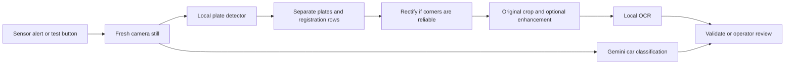

# Proposed plate localization and OCR flow

The current application asks Gemini to classify the vehicle and return a tight box around its registration characters in the same call. The operator can redraw that box. A generic OpenCV contour fallback also exists; it is a rectangle heuristic, not a trained plate detector.

## Proposed implementation stages

1. **Current prototype:** retain Gemini's proposed box and the manual drag-to-correct box. Save original-image pixel coordinates. Compare engines on the exact same crop, and measure localization separately from OCR. A manually correct crop evaluates recognition but does not prove automatic detection works.
2. **Gate deployment:** run a small local YOLO detector trained specifically for license plates, including Thai plates and the actual entry/exit viewpoints. Restrict candidates to the configured gate region and associate the plate with the arriving vehicle. Generic COCO weights do not have a license-plate class. Run Gemini car classification alongside local localization and OCR, so OCR need not wait for the cloud call.
3. **Perspective handling:** use a detector with four plate corners, or a validated corner-refinement stage, to rectify tilted plates. Keep the mapping back to the original frame. An axis-aligned rectangle alone is insufficient to recover perspective reliably.
4. **Text regions:** preserve the full plate crop, then identify the registration row separately from province/header text. Include a margin around every character and Thai mark. The supplied four-plate photo must produce four separate detections; concatenating all rows would create a false registration. Keep province text as a separate field if needed for identity matching.
5. **Image preparation:** retain the color crop and compare a gentle grayscale/contrast variant. Avoid assuming stronger denoising or sharpening is always better. Upscaling changes pixel count but cannot recover missing detail. If both engines disagree or the source is too blurred, request a new still or operator review.
6. **Validation:** normalize spaces, hyphens, and Latin case for matching; preserve Thai letters and marks. Use plate-format validation as a review signal, not a reason to silently replace letters or digits. Return the original photo, box, crop, engine, latency, and review reason with each reading.



## Testing with the supplied images

`data/ocr_comparison_labels.csv` contains visually transcribed references and manually selected boxes. `scripts/benchmark_ocr.py` reads both raw and enhanced versions, records five warm runs, and reports exact match, CER, median latency, and p95 latency by text group. Four province crops, six English label crops, two numeric registrations, six Thai registrations, and the camera screenshot's provisional `AB385` reference are kept distinct.

For the camera screenshot, the manual registration reference is `(483, 200, 759, 285)` in the original 972 × 618 screenshot. The test of the existing Gemini box and OpenCV heuristic is recorded in `reports/plate_bbox_test.json`; the annotated image is local at `data/samples/ocr_benchmark/camera_bbox_test.jpg`. These are single-image observations, not a detector accuracy benchmark. The manual reference is approximate and should be reviewed when evaluating small IoU differences.

Use the original `/camera/snapshot` image for future trials. The provided screenshot contains a browser border and can contain display scaling/compression; it is not equivalent to a raw ESP32 JPEG. Evaluate detection recall and box overlap on held-out frames separately from exact registration accuracy and trigger-to-result latency. Group the split by physical plate or capture session so similar frames do not leak between training and testing.

The second camera screenshot (1132 × 748) was evaluated separately, with manual registration reference `(174, 470, 551, 602)`. Gemini returned `(168, 431, 561, 633)` in about 3.0 seconds, IoU 0.627 against that tighter row reference. The heuristic again selected a different object (IoU 0). Its results are in `reports/plate_bbox_followup.json`, its overlay in `data/samples/ocr_benchmark/camera_bbox_followup.jpg`, and its OCR test in `reports/ocr_camera_followup.md`. The two observed Gemini request times (66.2 s and 3.0 s) show why one request cannot establish typical cloud latency.

Reproduce the localization test (the `--gemini` flag makes a Gemini API request):

```bash
python scripts/benchmark_plate_box.py \
  --image data/samples/ocr_benchmark/photo_07_camera.png \
  --reference 174,470,551,602 \
  --output reports/plate_bbox_followup.json \
  --annotated data/samples/ocr_benchmark/camera_bbox_followup.jpg \
  --gemini
```

## Sources

- [Ultralytics detection training, validation and export](https://docs.ultralytics.com/tasks/detect/)
- [COCO class list](https://docs.ultralytics.com/datasets/detect/coco/)
- [OpenThai OCR Text, requested 2.0.0 release](https://huggingface.co/iapp/OpenThai2.1-OCR-Text-20261118/tree/v2.0.0)
- [EasyOCR official repository](https://github.com/JaidedAI/EasyOCR)
